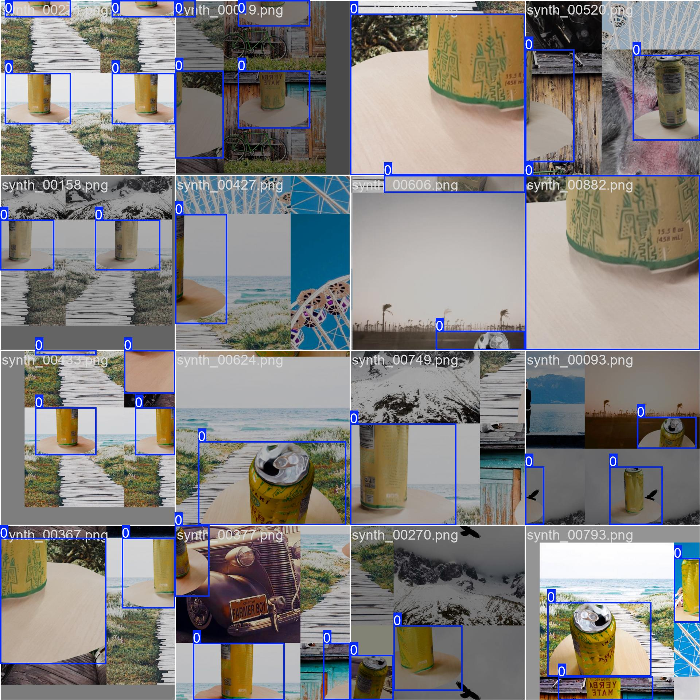
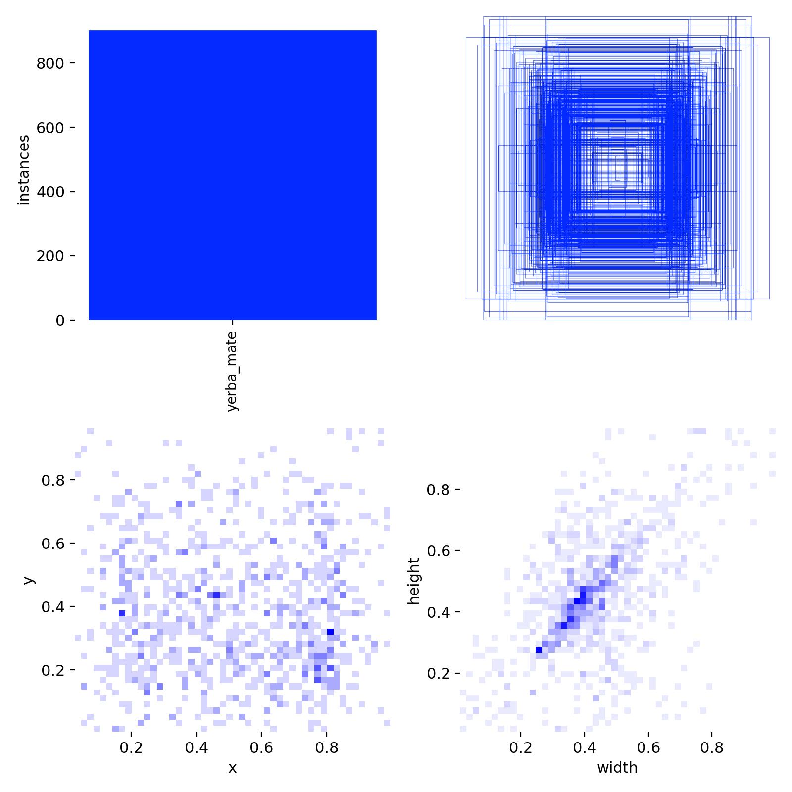

# CV-YOLO-Inspection

Synthetic-data tooling for visual inspection of beverage cans: Blender scripts that render labeled training images, Ultralytics YOLO training, and a convolutional autoencoder for anomaly detection.

I built this in summer 2025 during my research assistantship with Dr. Kevin Wedeward at Fort Lewis College, as the synthetic-data and detection tooling for that work. The thermal hotspot detector from the solar-panel inspection project is not in this repository.



*A training batch from the bundled model run: rendered yerba mate cans composited onto varied backgrounds, with mosaic augmentation applied by the Ultralytics trainer. These images come from the [robot_vision](https://github.com/Janga786/robot_vision) generator; it is the same training run.*

## What is here

- Headless Blender scripts that randomize camera, lighting, materials and simulated defects (scratch, dent, puncture) on can models and write a YOLO label for every render.
- Scripts that pull background images from Flickr, Openverse and Pexels.
- Dataset checks (`dataset_analyzer.py`, `check_images.py`, `diagnose_model.py`) for bounding boxes, image quality and class balance.
- A 4-class YOLO dataset config (`can`, `scratch`, `dent`, `puncture`) with its label files.
- A TensorFlow/Keras convolutional autoencoder (`train_autoencoder.py`) meant to flag defective cans by reconstruction error.
- `models/trained_model.zip`: Ultralytics YOLO11s weights from one single-class run (class `yerba_mate`), with its training config and plots.

## Limits

- All training data is synthetic. Nothing in this repository evaluates a model on real images.
- No held-out metric is reported. Both configs that trained or would train a detector here validate on their training images (`YOLO_2/defect_dataset/data.yaml` points `train` and `val` at the same folder; the bundled run used the same setup as `robot_vision/dataset.yaml`). Any validation score stored in the bundled weights is not evidence of generalization.
- The bundled weights are the single-class yerba mate detector, not a defect detector. No trained weights for the 4-class defect dataset are included.
- `YOLO_2/autoencoder_model/` holds the trained variables only (no `saved_model.pb`), and no autoencoder evaluation is included.

## Pipeline

1. **3D assets**: can meshes in FBX (`YOLO_2/source/Coke Can.fbx`, `YOLO_2/Synthetic_coke_pepsi.fbx`) with PBR texture support.
2. **Backgrounds**: `flickr_image_finder*.py`, `openverse_image_finder.py`, `cc_image_finder*.py`, `download_backgrounds.py`, plus optional HDRI environments.
3. **Rendering**: `enhanced_generator.py`, `enhanced_generator_v282.py` and `generate_detector_data.py` randomize camera position, focal length, three-point lighting and materials; simulate defects at configurable probabilities; and write YOLO labels. `known_good_config.json` holds a render configuration that worked.
4. **Checks**: `dataset_analyzer.py`, `check_images.py` and `diagnose_model.py`.
5. **Detector training**: Ultralytics YOLO on the exported dataset. The bundled run was trained on Google Colab.
6. **Anomaly detection**: `train_autoencoder.py` (local) and `train_autoencoder_colab.py` (Colab).

## Repository layout

```
CV-YOLO-Inspection/
├── YOLO_2/                          # Main pipeline
│   ├── enhanced_generator.py        # Blender generation engine (Cycles)
│   ├── enhanced_generator_v282.py   # Blender 2.82-compatible engine
│   ├── generate_detector_data.py    # Render + auto-label driver
│   ├── enhanced_runner.py           # Large batch generation runner
│   ├── run_continuous.py            # Long-running / resumable generation
│   ├── dataset_analyzer.py          # Dataset quality analysis
│   ├── *_image_finder*.py           # Background sourcing (Flickr, Openverse)
│   ├── train_autoencoder.py         # Convolutional autoencoder (anomaly detection)
│   ├── autoencoder_model/           # Trained autoencoder variables
│   ├── defect_dataset/              # YOLO labels + data.yaml (4 classes)
│   ├── source/                      # 3D can assets (FBX)
│   ├── known_good_config.json       # Working render configuration
│   └── README_ENHANCED_SYSTEM.md    # Generator documentation
├── models/
│   └── trained_model.zip            # YOLO11s weights + training artifacts
├── docs/images/                     # Sample training visualizations
├── LICENSE
└── README.md
```

Large generated datasets, HDRI files and standalone checkpoints are excluded from version control (see `.gitignore`).

## Trained model

`models/trained_model.zip` contains:

- `my_model.pt`: Ultralytics YOLO11s weights (Ultralytics 8.3.158, June 2025), one class, `yerba_mate`
- `train/args.yaml`: the training configuration (YOLO11s, 20 epochs, 640 px images, batch 16)
- `train/train_batch*.jpg`, `train/labels.jpg`, `train/labels_correlogram.jpg`: training mosaics and label plots

Label statistics from that run (about 900 labeled instances):



## Setup

Prerequisites: Python 3.8+, Blender 2.82+ on `PATH` (rendering runs headless via `blender --background`), and a CUDA GPU if you want reasonable render and training times.

```bash
git clone https://github.com/Janga786/CV-YOLO-Inspection.git
cd CV-YOLO-Inspection/YOLO_2
pip install ultralytics tensorflow opencv-python numpy matplotlib pandas pillow tqdm
```

Several scripts contain absolute paths from my original machine (for example `/home/janga/YOLO_2/...` in `defect_dataset/data.yaml` and `train_autoencoder.py`). Update them before running. The Pexels download scripts read the key from the `PEXELS_API_KEY` environment variable.

## Usage

Smoke-test the generator (renders a few images to check model placement, textures and labels):

```bash
cd YOLO_2
python3 generate_dataset.py
```

Generate a larger dataset with quality monitoring:

```bash
python3 enhanced_runner.py
```

Analyze a generated dataset:

```bash
python3 dataset_analyzer.py <dataset_dir>
```

Train a detector (add a held-out `val` split to `data.yaml` first if you want a meaningful score):

```python
from ultralytics import YOLO

model = YOLO("yolo11s.pt")
model.train(data="defect_dataset/data.yaml", epochs=20, imgsz=640, batch=16)
```

Run inference with the bundled weights:

```python
from ultralytics import YOLO

model = YOLO("my_model.pt")  # extracted from models/trained_model.zip
results = model.predict("path/to/image.jpg")
```

Train the autoencoder (after updating `DATASET_PATH`):

```bash
python3 train_autoencoder.py
```

See `YOLO_2/README_ENHANCED_SYSTEM.md` for generator options and output structure.

## License

MIT. See [LICENSE](LICENSE).
